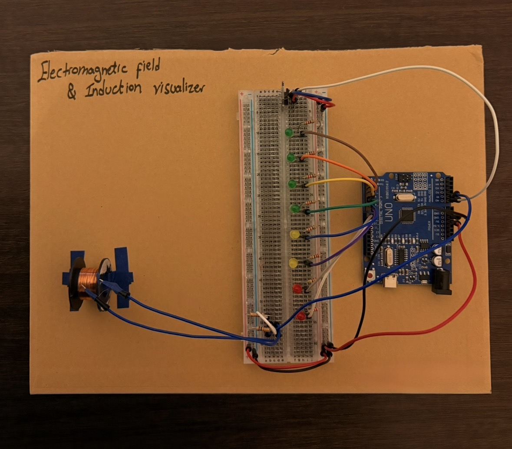

# Electromagnetic Field & Induction Visualizer

A dual-mode embedded physics instrument built on an **Arduino UNO R3** that measures and visualizes both **static magnetic field strength (B)** using a linear Hall effect sensor and **dynamic induced voltage (E_ind)** using a custom ~258-turn copper induction coil.

**Watch the Live Hardware Demo:** [Arduino Hardware Demo Video](https://youtu.be/oP1uxjK3srU)

---

## Overview & Physics Principles

This project demonstrates two fundamental laws of electromagnetism in real time using live USB Serial data (`115200` baud) and an 8-LED intensity bar graph:

### 1. Mode 1 — Hall Effect Magnetic Field Meter (B)
* **How It Works:** When a magnetic field passes perpendicular to electric current flowing inside a semiconductor chip (the **Hall Effect**), it deflects the moving electrons sideways and produces a measurable voltage shift proportional to magnetic field strength:
  * **Formula:** `B = (V_out - V_0) / S`
  * **`V_out`** = Sensor output voltage measured by the Arduino (`0 V` to `5 V`)
  * **`V_0`** = Auto-calibrated resting zero-field baseline (`~2.61 V`)
  * **`S`** = Sensor sensitivity (`14 mV/mT` for the 49E Hall element)
* **Measured Performance:** Measures both field strength and magnetic polarity (**`+mT`** vs. **`-mT`**) for stationary and moving magnets, reaching sensor saturation around **`+121 mT`** on one pole and **`-130 mT`** on the opposite pole.

### 2. Mode 2 — Faraday Electromagnetic Induction Coil (E_ind)
* **How It Works:** According to **Faraday’s Law of Induction** and **Lenz’s Law**, a changing magnetic flux (`ΔΦ`) through a coil of `N` turns induces an electromotive force (voltage) that opposes the change:
  * **Formula:** `E_ind = -N * (ΔΦ / Δt)`
  * **`N`** = Number of copper wire turns (`~258 turns`)
  * **`ΔΦ / Δt`** = Rate of change of magnetic flux over time
* **2.5 V Voltage Divider Design:** Because moving a magnet into and out of the coil produces both positive (`+`) and negative (`-`) voltage spikes, two equal **`10 kΩ` resistors** split the `5 V` supply in half (`2.5 V`). This shifts the coil's resting zero point into the middle of the Arduino's `0–5 V` input range so both positive and negative pulses are captured.
* **Measured Performance:** Passing stacked `10×5 mm` neodymium magnets through the ~258-turn coil (`1.5 cm` inner diameter, `~15 m` wire length) generates peak induced voltages between **`0.024 V`** (slow entry) and **`0.147 V`** (rapid exit).

---

## Hardware & Bill of Materials

| Component | Specification | Purpose |
| :--- | :--- | :--- |
| **Microcontroller** | Arduino UNO R3 (ATmega328P) | 10-bit ADC sampling (`0–1023`), signal processing, USB Serial |
| **Hall Effect Sensor** | KY-035 Module (49E Linear Hall IC) | Measures static & dynamic magnetic flux density (`mT`) |
| **Induction Coil** | ~258 turns of `0.1 mm` enameled copper wire (`1.5 cm` core) | Generates induced voltage from changing magnetic flux |
| **Bias Resistors** | `2 × 10 kΩ` (`0.5 W`) | Creates a `2.5 V` midpoint reference for bipolar coil readings |
| **LED Bar Graph** | `8 × 5 mm` LEDs (4 Green, 2 Yellow, 2 Red) | Visualizes real-time field/voltage intensity |
| **Current Limiters** | `8 × 220 Ω` resistors | Limits LED current in an **Active-Low** configuration |
| **Magnets** | `10×5 mm` Neodymium Disc Magnets | Magnetic flux source |

---

## Circuit Wiring Guide

### 1. Sensors & 2.5 V Voltage Divider

| Component Pin | Arduino / Breadboard Connection | Notes |
| :--- | :--- | :--- |
| **KY-035 `VCC` / `GND`** | `+5V` / `GND` Rails | Sensor power supply |
| **KY-035 `S` (Signal)** | Analog Pin **`A0`** | Resting baseline auto-calibrated at startup (`~535` ADC) |
| **Voltage Divider (`2.5 V`)** | `5V` → `10 kΩ` → Midpoint ← `10 kΩ` ← `GND` | Biases coil reference to `~2.50 V` (`~512` ADC) |
| **Induction Coil Lead 1** | Voltage Divider Midpoint (`2.5 V`) | Reference side of coil |
| **Induction Coil Lead 2** | Analog Pin **`A1`** | Measures induced voltage swing around `2.5 V` |

### 2. Active-Low 8-LED Bar Graph
Pins `0` (`RX`) and `1` (`TX`) are left open for USB Serial communication. All 8 LEDs are wired in an **Active-Low** configuration (anodes connected to `+5V` through `220 Ω` resistors; cathodes connected to Digital Pins `2–9`, where `LOW` = ON and `HIGH` = OFF):

* **Green LEDs (1–4):** Digital Pins **`2, 3, 4, 5`**
* **Yellow LEDs (5–6):** Digital Pins **`6, 7`**
* **Red LEDs (7–8):** Digital Pins **`8, 9`**

---

## Firmware & Signal Processing (`electromagnetic_visualizer.ino`)

The embedded C++ code uses zero external libraries and includes:
1. **Startup Auto-Calibration:** Averages 50 readings on `A0` and `A1` during boot (`setup()`) to lock onto the exact zero-field (`hallRest`) and `2.5 V` midpoint (`coilRest`) baselines automatically.
2. **Interactive Mode Switching:** Type **`1`** in the Serial Monitor (`115200` baud) for **Hall Magnetic Field (`mT`)** or **`2`** for **Faraday Induction (`V`)**.
3. **Peak-Capture & Visual Hold (Mode 2):** Continuously samples `A1` over a **`60 ms` window** to capture the highest voltage peak of a magnet pass, filters out `50 Hz` room hum (`< 0.034 V` / `7` ADC steps), and holds LED flashes for **`150 ms`** so fast spikes remain clearly visible.

---

## How to Run

1. Open `electromagnetic_visualizer.ino` in the **Arduino IDE**.
2. Keep magnets at least `30 cm` away from the board during power-up/upload so baseline calibration is accurate.
3. Select **Arduino UNO** and your USB port, then click **Upload**.
4. Open **Serial Monitor** at **`115200` baud**:
   * Enter **`1`** to measure magnetic field strength (`mT`) and polarity with the Hall sensor.
   * Enter **`2`** to detect induced voltage spikes (`V`) by passing magnets through the copper coil.
